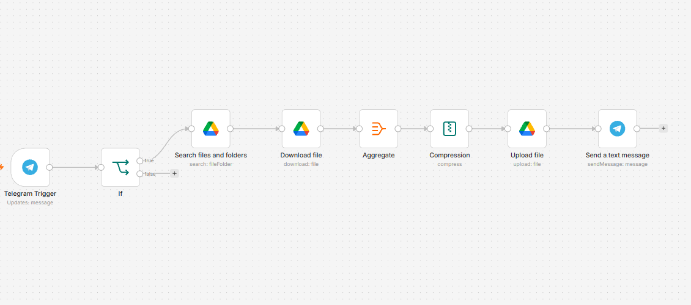

# 📦 Автоматическая архивация файлов Google Диска в ZIP через Telegram

Сценарий автоматизации в n8n, который по триггерной команде из Telegram скачивает рабочие исходники из папки дизайнеров на Google Диске, упаковывает их в единый ZIP-архив и выгружает в целевую папку готовых материалов. Решение исключает ручное скачивание десятков разрозненных файлов менеджером контента и автоматизирует пайплайн подготовки креативов к публикации.



## 🚀 Ключевые возможности

* **Строгая валидация входящей команды:** узел `If` проверяет текст входящего сообщения (`.trim().toLowerCase() === "готово"`), отсекая посторонние сообщения и случайные запуски.
* **Пакетная выгрузка и скачивание:** нода `Search files and folders` находит все объекты в исходном каталоге (`New_Creatives`), а `Download file` последовательно забирает их бинарные данные по `fileId`.
* **Агрегация бинарных потоков:** нода `Aggregate` (режим `aggregateAllItemData`) объединяет разрозненные бинарные файлы в один контекст для передачи архиватору.
* **Нативная компрессия в ZIP:** узел `Compression` собирает все входящие бинарные ключи в архив `creatives_pack.zip` без использования внешних CLI-утилит.
* **Обратная связь в чат:** после загрузки архива в папку `Ready_to_Post` бот отправляет HTML-уведомление инициатору задачи в Telegram.

## 🏗 Архитектура и стек

* **Оркестрация:** n8n (self-hosted / cloud)
* **Интерфейс управления:** Telegram Bot API (`Telegram Trigger`, `Send a text message`)
* **Хранилище данных:** Google Drive API v3 OAuth2 (`Search`, `Download`, `Upload`)
* **Обработка данных:** Встроенные ноды `Aggregate`, `Compression` (ZIP)

```text
[ Telegram: "готово" ]
          │
          ▼
   [ Telegram Trigger ]
          │
          ▼
      [ If Node ] ── (false: текст != "готово") ──▶ [ Завершение без действий ]
          │ (true)
          ▼
[ Google Drive: Search ] ──▶ Находит файлы в New_Creatives
          │
          ▼
[ Google Drive: Download ] ──▶ Скачивает бинарные данные каждого файла
          │
          ▼
   [ Aggregate Node ] ──▶ Объединяет бинарники в единый Item
          │
          ▼
  [ Compression Node ] ──▶ Упаковывает в creatives_pack.zip
          │
          ▼
 [ Google Drive: Upload ] ──▶ Загружает ZIP в папку Ready_to_Post
          │
          ▼
  [ Telegram: Send ] ──▶ Уведомление: "Файлы успешно отправлены в папку Ready_to_Post✅"
```

## 🛠 Быстрый старт и установка

[Готовый шаблон JSON для скачивания](google_drive_archiver_template.md)

### Предварительные требования

1. Развернутый экземпляр **n8n** (self-hosted на VDS через Docker или n8n Cloud).
2. **Telegram Bot Token**: полученный через [@BotFather](https://t.me/BotFather).
3. **Google Drive OAuth2 Credentials**: настроенный проект в Google Cloud Console с включенным Google Drive API и правами на чтение/запись.
4. Две папки на Google Диске: исходная (`New_Creatives`) и целевая (`Ready_to_Post`).

### Пошаговый запуск

1. **Импорт сценария:**
   * Скопируйте содержимое JSON-файла workflow (`google_drive_archiver_template.json`).
   * В интерфейсе n8n нажмите **Add workflow** -> **Import from JSON** (или комбинацию `Ctrl + V` на холсте редактора).
2. **Привязка Credentials:**
   * В нодах `Telegram Trigger` и `Send a text message` укажите созданное подключение **Telegram API**.
   * В нодах `Search files and folders`, `Download file` и `Upload file` выберите подключение **Google Drive OAuth2 API**.
3. **Конфигурация ID папок:**
   * Откройте ноду `Search files and folders`, в поле `Folder` выберите папку `New_Creatives` (или вставьте её ID вместо `YOUR_SOURCE_FOLDER_ID`).
   * Откройте ноду `Upload file`, в поле `Folder` выберите папку `Ready_to_Post` (или укажите её ID вместо `YOUR_TARGET_FOLDER_ID`).
4. **Активация:**
   * Переключите тумблер workflow в верхнем правом углу в положение **Active** (Published).
   * Отправьте в диалог с ботом слово `готово`.

## 🛡 Обработка краевых случаев (Edge Cases)

| Сценарий | Поведение системы | Результат |
| :--- | :--- | :--- |
| Пользователь отправил произвольный текст («Привет», «Сделай архив») | Условие в узле `If` проверяет выражение `$json.message.text.trim().toLowerCase() === "готово"` | Ветка `False`. Сценарий корректно прерывает выполнение, запросы к Google Drive не отправляются |
| Папка `New_Creatives` пуста | Нода `Search files and folders` возвращает 0 элементов | Последующие ноды загрузки и сжатия не получают входных данных, процесс безопасно завершается |
| Различные типы файлов (PNG, JPG, PDF, TXT) | Нода `Compression` динамически считывает ключи `Object.keys($binary).join(',')` | Все разнородные бинарные файлы корректно упаковываются в единый ZIP без потери расширений |
| Сбой авторизации Google Drive API | n8n генерирует ошибку выполнения на шаге обращения к API | Исполнение прерывается со статусом `Error` в истории Executions без повреждения существующих файлов |

## 📊 Метрики эффективности

| Параметр | Значение | Примечание |
| :--- | :--- | :--- |
| **Среднее время исполнения** | ~20–25 сек | Зависит от объема файлов (тестовый прогон: 7 файлов ~1.6 МБ выполнен за 24.5 с) |
| **Себестоимость запроса** | $0.00 | Используются стандартные API Google и Telegram без обращения к платным LLM |
| **Потребление RAM** | ~35–50 МБ | Обработка бинарных данных происходит в оперативной памяти инстанса n8n |
| **Экономия времени** | ~3–5 мин / итерация | Исключает ручной выбор, скачивание каждого файла и ручную загрузку ZIP-архива |

## Контакты

* **Автор проекта:** Kodzhi Tanaka
* **Telegram для связи:** [@TanakaKodzhi](https://t.me/TanakaKodzhi)
* **Telegram-канал:** [Build -> Запуск](https://t.me/tanaka_dev) — разработка автоматизаций, no-code/full-stack решения и self-hosted пет-проекты
